
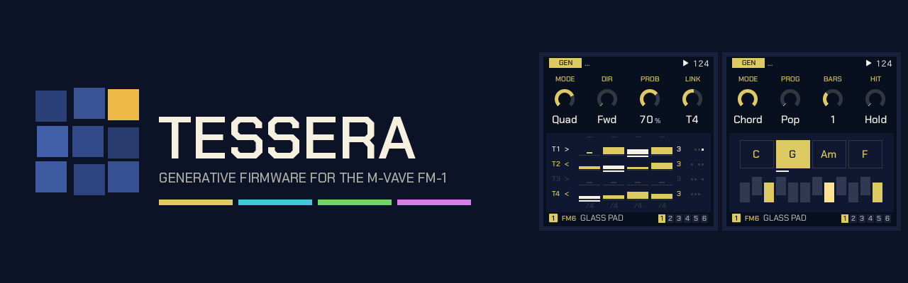

# Tessera 2.0 manual

Tessera is a generative firmware for the M-Vave FM-1. It grew out of Melodee (Tess), a fork of
[Melodee](https://github.com/keremimo/melodee) by keremimo (itself built on *Felucca* by Leo Kuroshita / Hügelton
Instruments). Each of the four tracks can play its own steps, an arpeggio, or one of twelve generators, and the
pages around them evolve the phrases, build song forms, pass hits between tracks and modulate anything from
anything.

This manual covers what Tessera adds and changes. The step sequencer, the effects and the song pages work as in
upstream Melodee. For recipes and tips, see **[RECIPES.md](RECIPES.md)**. Every setting, with its range and
default, is listed in [docs/PARAMETERS.md](docs/PARAMETERS.md).

Page and knob names are the ones on the screen. KNOB 1 to KNOB 4 are the four knobs from left to right, and each
page's four settings sit along the top of the screen in the same order.

- [The panel at a glance](#the-panel-at-a-glance)
- [Shortcuts](#shortcuts)
- [Sounds](#sounds)
- [SEQ: the MODE and its pages](#seq-the-mode-and-its-pages)
- [The generators](#the-generators)
- [OCT+ layers on GEN](#oct-layers-on-gen)
- [EVOLVE](#evolve)
- [FORM](#form)
- [TWEAK](#tweak)
- [TWEAK 2](#tweak-2)
- [LENGTH](#length)
- [Print and keep](#print-and-keep)
- [Harmony: CHORD and QNT CHRD](#harmony-chord-and-qnt-chrd)
- [MODS: the modulation cords](#mods-the-modulation-cords)
- [MATRIX](#matrix)
- [ORGANIC: SLOTH and OCHD](#organic-sloth-and-ochd)
- [Mod shortcut](#mod-shortcut)
- [Help card](#help-card)
- [Menu and settings](#menu-and-settings)
- [Saving and older projects](#saving-and-older-projects)
- [If something goes wrong](#if-something-goes-wrong)
- [Credits](#credits)

---

## The panel at a glance

| Button | Tap | Hold |
|---|---|---|
| **HOME** | The home page: four tracks, their sounds and knobs | The menu |
| **SEQ** | GEN, then the pages of the track's MODE | PATTERNS (the song under it) |
| **ARP** | ARP's MODE and its page (again: ARP 2) | The help card for any knob you turn |
| **LFO** | MODS, MATRIX, LFO, LFO 2, ORGANIC, LFO DEST | |
| **ENV** | ENV, ENV DEST | |
| **SCL** | SCALES, SCL, CHORD | |
| **EDIT** | The sound's EDIT pages; on an EDIT page, the map | With OCT- / OCT+: undo / redo |
| **FX** | The insert and send effects | The mod amount of any knob you turn |
| **GLO** | GLOBAL, SYSTEM, MIXER | |
| **SAVE** | PRESETS, USER, PROJECT | With REC: save the project to its slot |
| **REC** | Record | Capture or print the last bars (see [Print and keep](#print-and-keep)) |
| **OCT+** | Octave up; on some pages, an action (shown on screen) | A page's extra layer (see [OCT+ layers](#oct-layers-on-gen)) |

On the home page each track's tile shows its sound and engine. **SELECT** picks the track (or the left knob, with
MENU > TRACK KNOB set to LEFT). The four sounds a new project starts with are an ambient set: **GLASS PAD**,
**STRINGS** and **BELLS** on FM6, and the **808 KIT** on DRUM. A new project has no mods, so nothing moves until
you patch it.

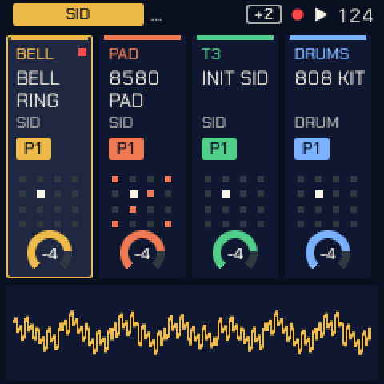 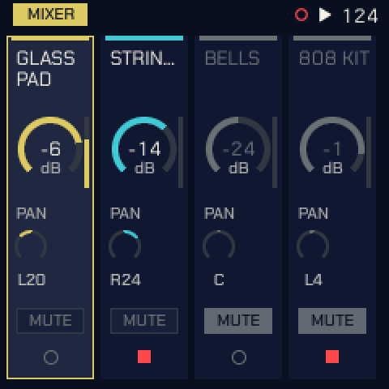

**Lists** (the HOME menu, SCL, VOICE, the sheets and the sound designer): KNOB 1 picks the row, KNOB 2 changes its
value.

**The look.** Tessera's palette is **SMALTI**, lapis and gold. MARMO, VITRO, NIGHT and CONTRAST are in MENU >
COLOR. Each track has its own colour, used for its tile, its cords and its row in MATRIX.

---

## Shortcuts

| Do this | And this happens |
|---|---|
| Tap **SEQ** | **GEN** first: KNOB 1 (**MODE**) picks what the track plays. SEQ then shows only that mode's pages. |
| Tap **ARP** | Switches a STEP track to ARP and opens **ARP**; tap again for **ARP 2**. On a generator track it opens GEN instead ("ARP: MODE ON GEN"), so a playing generator never goes quiet by accident. |
| Hold **OCT+** on GEN | The generator's second layer, for QUAD, CHORD, GRIDS and CONSTELLATION (see [OCT+ layers](#oct-layers-on-gen)). |
| **GEN** on an AWAKE track, a white key | Picks that step: KNOB 1 sets its A, KNOB 2 its B. The same key lets it go. |
| Hold **ARP**, turn a knob | The [help card](#help-card) for that knob. Turn the same knob further to make the text larger or scroll it. |
| Hold **FX**, turn a knob | Sets how far a cord moves that knob's parameter (see [Mod shortcut](#mod-shortcut)). |
| Hold **REC** | On a generator track: prints its last bars into STEP. On STEP EVOLVE: keeps the changes. On a STEP track: captures what you just played. |
| Hold **EDIT**, press **OCT-** / **OCT+** | Undo / redo. |
| **SAVE** + **REC** | Saves the project to its slot (stops playback first). |
| **EVOLVE**, KNOB 4 (**ROLL**) | Each click is a new seed (1 to 128), so a new line; turn back for the last one, note for note. |
| **FORM**, KNOB 3 (**CLEAR**) | Forgets B and C: the section playing becomes A. |
| **MODS**, **OCT+** | Switches the picked mod between BI and UNI. |
| **MATRIX**, **OCT+** | Opens the picked mod in MODS. |
| **EDIT** on an EDIT page | The map of the sound's pages: KNOB 1 across a row, KNOB 2 between rows, OCT+ opens the page, OCT- or EDIT closes it. Any other page button leaves it for its page. |
| **PLAY** | Every generator starts its random choices from the top of its seed, and SLOTH and OCHD restart: with EVOLVE's EVERY off, a project plays the same way each time. |

---

## Sounds

Tessera 2.0 has three engines on the device:

| Engine | What it is |
|---|---|
| **FM6** | Six-operator FM in the manner of the DX7: 32 algorithms, operator envelopes and scaling, pitch EG, LFO and the function settings (bend, porta, wheel, foot, breath, aftertouch). Its ENGINE setting picks MODERN, MARK I (the DX7's own tables) or OPL. The main melodic voice. |
| **TRIO** | Three oscillators: WAVE, INT2, INT3 (intervals) and DETUNE. Basses and leads. |
| **DRUM** | Drum kits: **808**, **909** and **SID KIT** (every drum on a C64 chip). Eight lanes: BD, SD, CP, CH, OH, TM, RS, CB. The 808 has six tom pitches. |

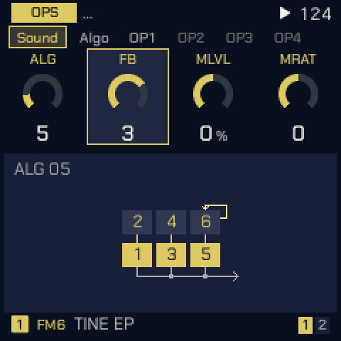 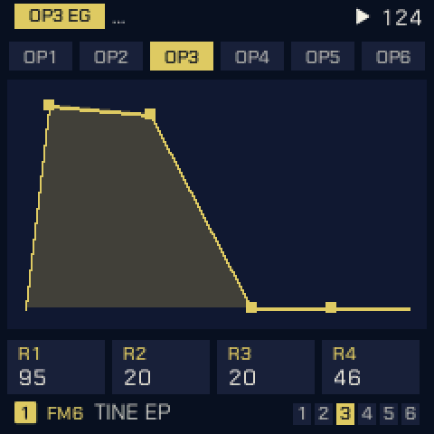 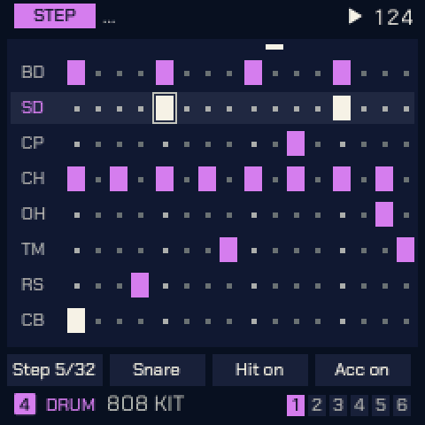

**SID** and **PHYS** are no longer in the device build, and neither are CZ-1 and Prophet. A track saved with SID
loads FM6's INIT; one saved with PHYS loads FM6's first voice. DRUM's SID KIT stays. FM6 presets have releases that
ring out, so short sequenced notes are not cut off.

**PRESETS** (SAVE) browses the sounds. Its LIST knob picks ALL, the favourites, RECENT or a category, and it starts
on ALL at power-on.

---

## SEQ: the MODE and its pages

Tap **SEQ** for **GEN**, where **KNOB 1, MODE** picks what the selected track plays:

- **STEP**: the step sequencer.
- **ARP**: the arpeggiator over the keys held (the ARP button gets here too).
- One of twelve generators: **TURING**, **EUCLID**, **MARKOV**, **MORPH**, **GRIDS**, **BOUNCE**, **AWAKE**,
  **POLY**, **QUAD**, **CONSTL** (Constellation), **SERIES** or **CHORD**.

SEQ then shows only that mode's pages:

| MODE | SEQ's pages |
|---|---|
| **STEP** | GEN, EVOLVE (STEP EVOLVE), NOTES, PATTERN, TEMPO, PATTERNS, SONG |
| **ARP** | GEN, ARP, ARP 2, NOTES, PATTERN, TEMPO, PATTERNS, SONG |
| a generator | GEN, EVOLVE, FORM, TWEAK, TWEAK 2, LENGTH, PATTERN, TEMPO, PATTERNS, SONG |

MOTION and DRUM HIT appear as in upstream. With STEP, GEN's KNOB 2 to 4 are DIVISION, SWING and GATE. The
generators run at the track's DIV (PATTERN page) and play in the track's scale (SCL). Choosing STEP or a
generator turns the arpeggiator off; choosing ARP again brings back its last setting.

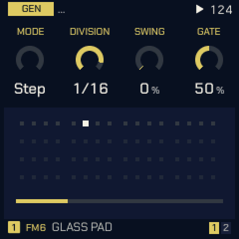

---

## The generators

Each generator's three settings are on GEN, KNOB 2 to 4, and the panel under them shows what it plays. Every
generator is also a mod source: its **GATE**, its **NOTE** and a **CV** (see [MODS](#mods-the-modulation-cords)).

| MODE | KNOB 2 | KNOB 3 | KNOB 4 | What it plays |
|---|---|---|---|---|
| **TURING** | LENGTH (2–16) | PROB (0–100 %) | SPAN (1–3 oct) | A looping shift register, as a Turing Machine. PROB is the chance a step changes as it comes round: 0 locks the loop (the knob reads Lock), 100 is new every pass. |
| **EUCLID** | STEPS (1–32) | PULSE | ROT | Hits spread as evenly as they go over STEPS, turned round by ROT, on pitches picked by the seed. |
| **MARKOV** | LEAP (0–100 %) | DENS (5–100 %) | SPAN (1–3 oct) | A random walk over eight scale degrees. LEAP 0 moves to neighbours, 100 leaps widely. DENS is the chance a step plays. |
| **MORPH** | POS (0–127) | SNP A (0–7) | SNP B (0–7) | A rhythm blended from preset A into preset B. POS starts halfway. |
| **GRIDS** | X (0–255) | Y (0–255) | DENS (0–100 %) | Émilie Gillet's Grids (Mutable Instruments): its drum map, kick, snare, closed hat and a fourth part from the point X, Y. Best on a DRUM track. More on the [OCT+ layer](#grids-kick-snr-hat-toms). |
| **BOUNCE** | SPEED (1–64) | ANGLE (0–90°) | BALLS (1–4, Fall) | Balls in a box: a note where a ball hits a wall. Each extra ball starts from its own place and angle; balls that hit on the same step play together, three notes at most. Past 4, **FALL** (after ambalek's norns script Fall): eight leaves fall at their own speeds and play where they land (left low, right high), and ANGLE becomes **WIND**: calm in the middle, leaning the melody low or high either side, gusting further out. |
| **AWAKE** | LEN A (1–16) | LEN B (1–16) | PROB (0–100 %) | Two loops, as norns' Awake. A is the melody (scale degrees or rests), B lifts it up the scale; different lengths shift B against A. Steps can be set from the keys (below). |
| **POLY** | RHY (1–4) | DIVISION (OFF, /1–/16) | SPAN (1–3 oct) | Four notes stepped on by four rhythms. RHY picks which rhythm DIVISION edits. Rhythms that land together play once, louder: /4 against /3 is a polyrhythm. |
| **QUAD** | DIR | PROB (0–100 %) | LINK | A 4 x 4 grid of notes the four tracks share, a row each, inspired by the norns script initenere. Each QUAD track plays its row on its own DIV, so the polyrhythm comes from the tracks' speeds. DIR: FWD, BACK, PEND, RAND or HOLD. LINK: the other QUAD tracks this one's steps also move on (HOLD tracks then play only when pulled). More on the [OCT+ layer](#quad-columns-and-range). |
| **CONSTL** | Y (0–14) | DENS (0–100 %) | SPEED | After timothy-taylor's norns script Constellation: a ship flies through a sky of stars; the stars that cross its crosshair play. Y is the crosshair's height (where the melody sits), DENS how many stars, SPEED how fast the sky passes (the straight note values, slow to fast). More on the [OCT+ layer](#constellation-lock-len-fill-size). |
| **SERIES** | START (0–127) | INTV (1–7) | LOOP (OFF, 1–16) | Per Nørgård's infinity series (after the norns script nørgård): a melody alike at every scale. START picks where it begins, INTV how many scale degrees a step of the series is, LOOP repeats that many steps (OFF never repeats). |
| **CHORD** | PROG | BARS (½, 1, 2, 4) | HIT | A progression's chords in the track's scale: POP (I V vi IV), 50S, 2-5-1, CIRCLE, TWO, DRONE, WALK (four chords from the seed) or USER (your own). HIT: HOLD (once, held), BEAT or STEP. See [Harmony](#harmony-chord-and-qnt-chrd). |

<table>
<tr>
<td align="center" width="25%">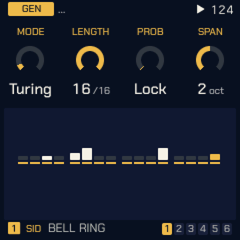 <b>TURING</b></td>
<td align="center" width="25%">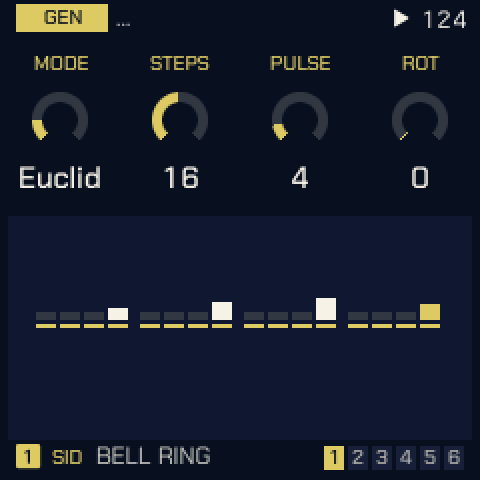 <b>EUCLID</b></td>
<td align="center" width="25%">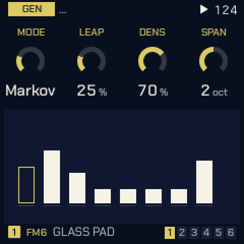 <b>MARKOV</b></td>
<td align="center" width="25%">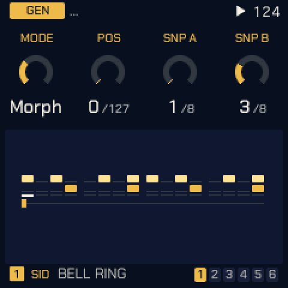 <b>MORPH</b></td>
</tr>
<tr>
<td align="center">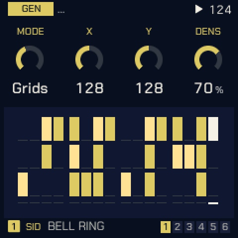 <b>GRIDS</b></td>
<td align="center">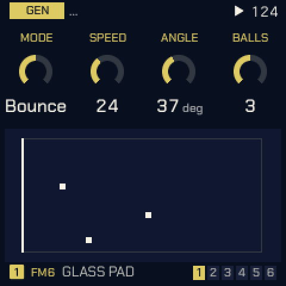 <b>BOUNCE</b></td>
<td align="center">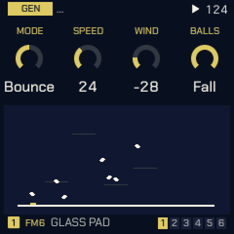 <b>FALL</b></td>
<td align="center">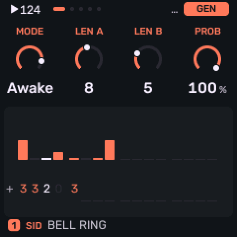 <b>AWAKE</b></td>
</tr>
<tr>
<td align="center">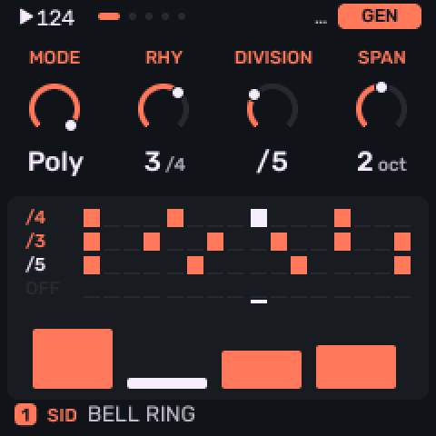 <b>POLY</b></td>
<td align="center">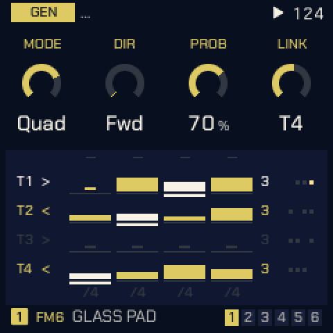 <b>QUAD</b></td>
<td align="center">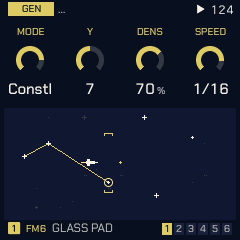 <b>CONSTL</b></td>
<td align="center">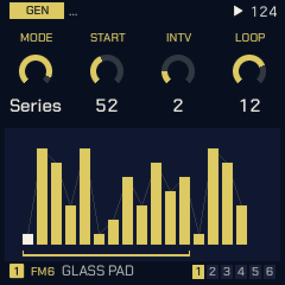 <b>SERIES</b></td>
</tr>
<tr>
<td align="center">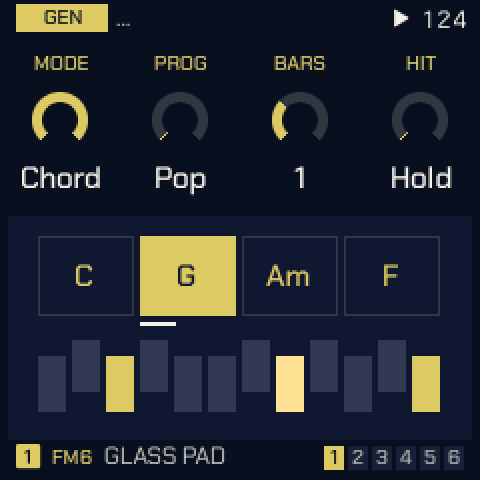 <b>CHORD</b></td>
<td></td><td></td><td></td>
</tr>
</table>

**AWAKE step entry.** On GEN with an AWAKE track the keys are its steps and play no sound. A white key picks a
step: KNOB 1 sets its A value, KNOB 2 its B. Press the same key again, or leave the page, to go back to the usual
knobs.

**Seeds.** Every generator's random choices come from the track's seed (EVOLVE's ROLL). A seed sets the starting
material too: Turing's register, Euclid's pitches, Markov's first state, Awake's loops, Poly's notes, Quad's cells,
the sky. A track gets a random seed the first time a generator is picked, so each power-on starts somewhere new; a
saved project keeps its seeds.

---

## OCT+ layers on GEN

Four generators have more settings than three knobs. Hold **OCT+** on GEN: the knobs' labels move onto tiles in the
track's colour, an OCT+ key shows in the header, and the four knobs set the layer. Let go to return.

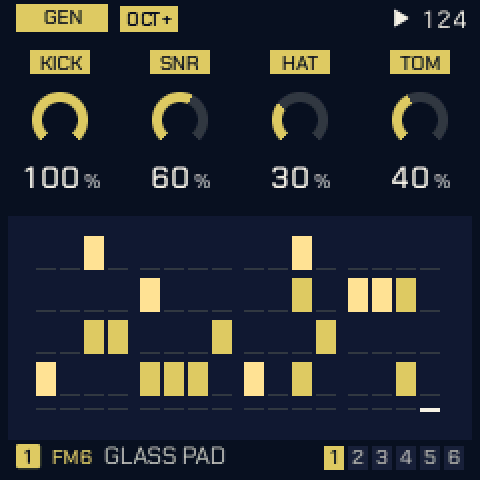 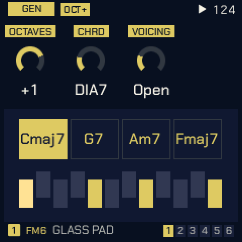 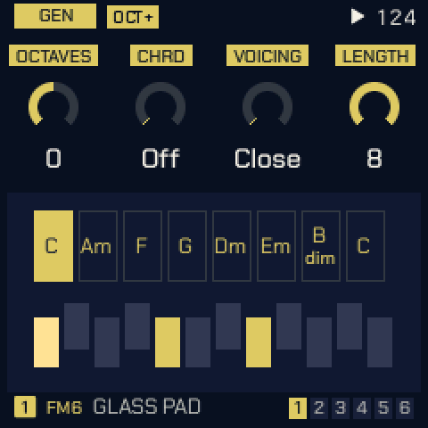

### GRIDS: KICK, SNR, HAT, TOMS

| Knob | Setting | What it does |
|---|---|---|
| 1 | **KICK** (0–100 %) | How much of DENS the kick gets: 0 silences it. |
| 2 | **SNR** | The same for the snare. |
| 3 | **HAT** | The same for the closed hat. |
| 4 | **TOMS** (0–100 %) | A fourth part: the hits the kick and snare only just miss, so fills follow the groove. 0 none. |

With OCT+ held, a **black key** picks the fourth part's sound, as on the drum grid: TOM, CLAP, OPEN HAT, RIM or
BELL. The parts are also mod destinations: G KICK, G SNR, G HAT, G TOMS.

### CHORD: OCT, CHRD, VOIC (and LEN)

| Knob | Setting | What it does |
|---|---|---|
| 1 | **OCTAVES** (−2 to +2) | The chords' register from their home around C3. |
| 2 | **CHRD** | SCL > CHORD's chord kind: OFF plays triads; DIA7 sevenths in the scale; MAJ, MIN, 7ths, SUS4, POW. |
| 3 | **VOICING** | CLOSE, OPEN, INV1, INV2 or +OCT. |
| 4 | **LENGTH** (USER only) | How many of USER's chords play, 1 to 8. |

**USER progressions.** Set PROG to USER, hold OCT+ on GEN and play the roots on the keys, one key a chord (the keys
are silent while OCT+ is held; notes outside the scale round down to it). Letting OCT+ go ends the entry, and the
number of chords played sets LENGTH.

### QUAD: columns and RANGE

The grid's columns can turn between the rows, so notes travel from track to track. With OCT+ held:
KNOB 1 picks the column, KNOB 2 its **MOVE** (STOP, DOWN, UP or RAND), KNOB 3 its **EVERY** (/1 to /16 steps of
the first QUAD track), and KNOB 4 **RANGE** (3 OCT, 1 OCT, 2 OCT or ±1: the octaves the row's notes fold into).

### CONSTELLATION: LOCK, LEN, FILL, SIZE

| Knob | Setting | What it does |
|---|---|---|
| 1 | **LOCK** | The chance a step plays the loop of stars already caught instead of the sky: high LOCK repeats a phrase. |
| 2 | **LEN** (1–16) | The loop's length. |
| 3 | **FILL** | OFF: the steps between stars rest. ARP: the last four stars again, low to high and softer. |
| 4 | **SIZE** (0–7) | How many rows either side of the crosshair a star still plays in. |

**AUTO** steers the ship for you: OFF follows Y, 1 to 9 is a wander of its own (faster further up), SEEK flies to
the next star. It has no knob: set it with a mod to **C AUTO** (a cord with no source is a fixed value).

---

## EVOLVE

On a generator track, EVOLVE mutates the phrase every few bars.

| Knob | Setting | What it does |
|---|---|---|
| 1 | **LOCK** (0–100 %) | How much of the phrase stays: 100 loops it, 0 is new every pass. Turing's LOCK is its PROB turned round, Grids' its CHAOS turned round, Constellation's the chance of its loop. Euclid, Bounce, Awake, Poly and Quad have none. |
| 2 | **EVERY** | Mutates every OFF, 1, 2, 4, 8 or 16 bars. OFF keeps the phrase. |
| 3 | **AMOUNT** (0–100 %) | How much changes each time. |
| 4 | **ROLL** (1–128) | The track's seed. While playing, a new seed starts on the track's next bar line (the number blinks until then). |

With LOCK up, Turing's loop is its LENGTH long; Markov's and Morph's loops are as long as PATTERN's **LEN**.

### STEP EVOLVE

On a **STEP** track, EVOLVE varies the steps you wrote, as they play, without changing them.

| Knob | Setting | What it does |
|---|---|---|
| 1 | **LOCK** (0–100 %) | How much of the variation stays from round to round: 100 holds it, 0 is fresh each time. |
| 2 | **EVERY** | Bars between rounds of changes; OFF plays the steps as written. |
| 3 | **AMOUNT** (0–100 %) | How many steps change, up to half: a note moved by a degree or two or an octave, a step dropped, two notes swapped, a ghost note in a rest. |
| 4 | **CLEAR** | Shows how many steps are changed now; turn it to go back to the steps as written. |

Hold **REC** to keep the changes playing: they become the steps (KEPT n STEPS). EDIT held undoes it. Switching
pattern clears the changes.

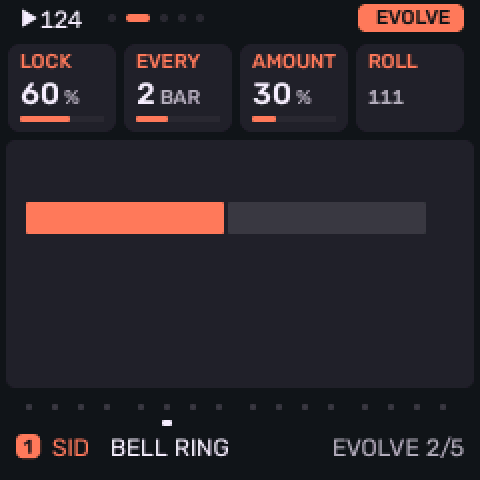 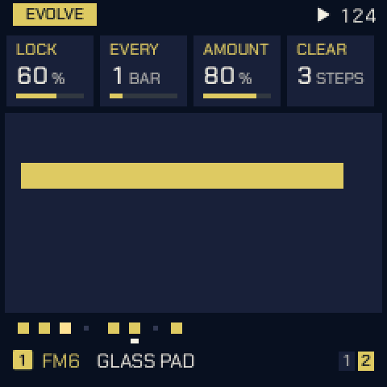

---

## FORM

FORM strings mutated phrases into a short song form of sections A, B and C, each EVERY bars long.

| Knob | Setting | What it does |
|---|---|---|
| 1 | **FORM** | OFF, AB, ABAC, ABCB, AABA, ABCA or AABC. Turning it on with EVERY OFF sets EVERY to 4 bars. |
| 2 | **CONTR** (0–100 %) | Contrast: how far a new section moves from the one before. |
| 3 | **CLEAR** | Forgets B and C: the phrase playing becomes A. |
| 4 | **FLRSH** (−12 to +12) | Flourish: semitones added on the last beat of every phrase; 0 is off. |

A section played again comes back exactly. B and C are made from the section before, by CONTR, the first time they
are reached. Changing MODE or ROLL starts the form again at A.

---

## TWEAK

| Knob | Setting | What it does |
|---|---|---|
| 1 | **SHIFT** (±24) | Transposes by semitones; while following, by scale steps from the followed note. |
| 2 | **DROP** (0–100 %) | The chance a hit is left out, whatever the generator. |
| 3 | **HUMAN** (0–100 %) | Varies velocity and gate a little, as a player would. |
| 4 | **FOLLOW** | OFF, or T1 to T4: plays that track's pitch, SHIFT away, in this track's scale. STEP tracks can be followed too. The followed track is drawn in its own colour. |

On a GRIDS track only DROP and HUMAN apply: SHIFT, FOLLOW and FLRSH would change which drum plays.

---

## TWEAK 2

TWEAK 2 decides which hits play, and where. Everything starts OFF.

| Knob | Setting | What it does |
|---|---|---|
| 1 | **BRANCH** (0–100 %) | The chance a hit plays on track TO's sound instead, so two tracks answer each other. The tosses replay with the seed. |
| 2 | **TO** | OFF, or a track and a mode: **COIN** tosses each hit, **TOGGLE** switches side on a toss won (100 % alternates), **LATCH** tosses once a bar. |
| 3 | **LOGIC** | OFF, AND, OR, XOR or NOT with another track's hits. A lower track's hit is read on this step, a higher one's on the step before. |
| 4 | **COND** | The bars a hit may play in, counted from PLAY (with FORM on, from the section's start): 1:2, 2:2, 1:4 to 4:4, 1:8, 8:8, FIRST or !FIRST. |

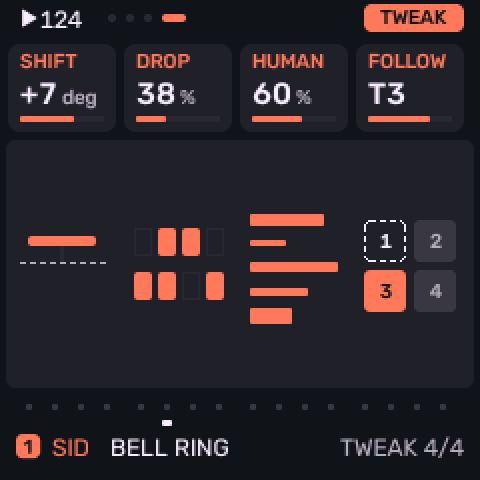 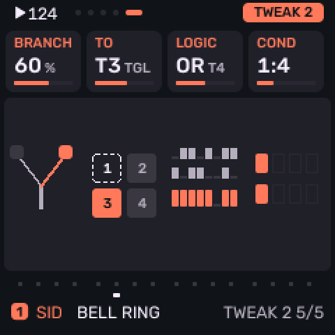

---

## LENGTH

How long a generator holds its notes.

| Knob | Setting | What it does |
|---|---|---|
| 1 | **LENGTH** | **STEP**: the step's GATE. **FIXED**: LEN, whatever the DIV. **HIT**: until the next hit, so rests let notes ring. GRIDS keeps STEP. |
| 2 | **LEN** | FIXED's length: 1/32 to 1/1 (a bar). |
| 3 | **KEYS** (1–4) | FIXED: how many notes may hold at once. |
| 4 | **GATE** | The track's step gate, as on PATTERN. |

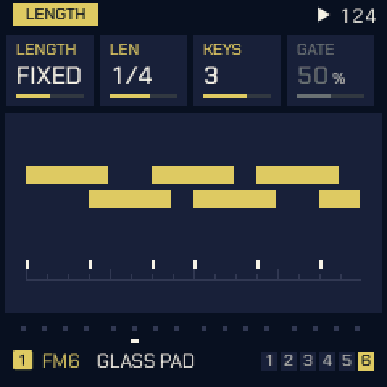

---

## Print and keep

Hold **REC** on a generator track to **print**: what the generator played in its last bars goes into the track's
STEP pattern (1, 2 or 4 bars, as many as the notes span), and the track switches to STEP and plays on from the same
place. Hold EDIT to undo, which puts the generator back.

- Steps written by hand already there: **REPLACE STEPS?** OCT+ prints over them, OCT- keeps them.
- Recorded notes there: **CLEAR PATTERN TO PRINT**.
- On a STEP track playing STEP EVOLVE's changes, REC held keeps the changes instead.
- On a STEP track without them, REC held captures what you played on the keys in the last bars.

---

## Harmony: CHORD and QNT CHRD

A **CHORD** track plays a progression; with **QNT CHRD** the other tracks follow it.

- On the CHORD track: GEN, MODE **CHORD**, then **PROG**, **BARS** and **HIT**. The chord's kind and voicing come
  from **SCL > CHORD** (CHRD, VOIC), or the OCT+ layer. CHRD OFF plays triads.
- On any other track: **SCL**, **QNT** to **CHRD**. Its keys, its MIDI input and its generator snap to the nearest
  note of the chord playing now. With no CHORD track, CHRD acts as SNAP.
- **CH PROG** is a mod destination, so a slow source can change progressions.

---

## MODS: the modulation cords

Tap **LFO** for **MODS**: up to 16 cords, each from a source on any track to a destination on any track. Four show
at a time, each with an activity light and a moving mark.

| Knob | What it sets |
|---|---|
| 1 | **Source**: `--`, then per track (T1 to T4) LFO, ENV, VEL, KEY, RAND, MODW, AT, EXPR, S&H, SLEW, the generator's GATE, NOTE and CV, DRIFT, SLOTH's TORPOR, APATHY and INERTIA, and OCHD 1 to 8. |
| 2 | **Mod**: which of the 16 the other knobs edit. |
| 3 | **Destination**, on a track: the voice (PITCH, CUTOFF, SHAPE, GAIN), the mix (LEVEL, PAN, SPREAD, FX SEND), the envelope and LFO settings, the engine's E1 to E8, and the generators' settings (T PROB, T LEN, E PULSE, E ROT, M LEAP, M DENS, MP POS, SHIFT, DROP, HUMAN, BRANCH, EV AMT, CONTR, G X, G Y, G DENS, G KICK, G SNR, G HAT, G TOMS, B SPEED, B ANGLE, A PROB, Q PROB, C Y, C SIZE, C DENS, C AUTO, S START, CH PROG). |
| 4 | **Amount**, −100 to +100 %. With no source (`--`) the cord is a fixed move and KNOB 4 sets its offset. |

- **BI and UNI.** A bipolar source (LFO at POL BI, KEY, RAND, S&H, SLEW, NOTE, DRIFT, SLOTH, OCHD) swings both
  ways from the knob. Press **OCT+** on MODS to make the picked mod **UNI**: the source folded to 0 to 1, so it moves
  one way only, as ENV does.
- Choosing a destination on a new cord sets the amount to 50 % (or a fixed move of 25 % with no source), so you hear
  it at once.
- **Live marks**: a knob a cord reaches shows a mark where the cords move it now.
- **DRIFT** is each track's slow wander, a new point about every 12 seconds, eased between.
- Melodee's MOD routes, in old projects and sounds, become cords when they load. If all 16 are in use the screen
  says **MODS FULL**.

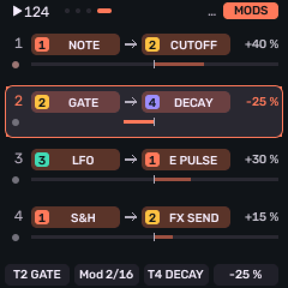 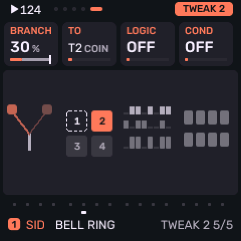

---

## MATRIX

MATRIX, after MODS, shows the cords as a 4 x 4 grid: source track down the left (FROM), destination track along the
top (TO). A cell is lit, in the source track's colour, when a cord goes that way, as bright as the cords move it now.

| Knob | What it does |
|---|---|
| 1 | **FROM**: the row. |
| 2 | **TO**: the column. |
| 3 | **MOD**: which of the cell's cords, when it holds more than one. |
| 4 | **OPEN**: press **OCT+** to open that cord in MODS. |

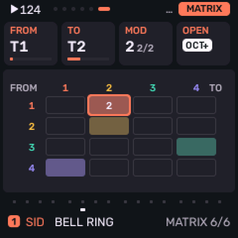

---

## ORGANIC: SLOTH and OCHD

Each track has its own SLOTH and OCHD, slow sources in the style of Nonlinearcircuits' Sloth and Instruō's ochd.

| Knob | Setting | What it does |
|---|---|---|
| 1 | **SPEED** (0–100) | SLOTH's speed. At 50 its three chaotic circuits take about 17 minutes (**TORPOR**), 1 minute (**APATHY**) and 3 minutes (**INERTIA**) a turn; each 12.5 more is twice as fast. |
| 2 | **RATE** (0–100) | OCHD's speed. At 50, **OCHD 1** takes 64 s a turn and **OCHD 8** 2.4 s; each 12.5 more is twice as fast. |

PLAY restarts them from the track's seed, so a piece replays the same way. Pick them as sources on MODS.

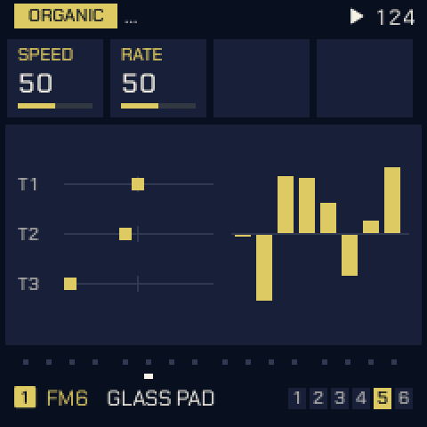

---

## Mod shortcut

Hold **FX** and turn a knob on any page: a cord from the track's shortcut source (its LFO, unless you turn SELECT
while FX is held to pick another) to that knob's parameter, on the same track. Turning sets the amount, like the
attenuverter beside a knob on a modular.

- The first turn makes the cord in a free MODS slot; back at 0 the slot is free again.
- If a cord already reaches that parameter on this track, that cord is edited, whatever its source.
- A parameter no cord can reach shows **no mod**.

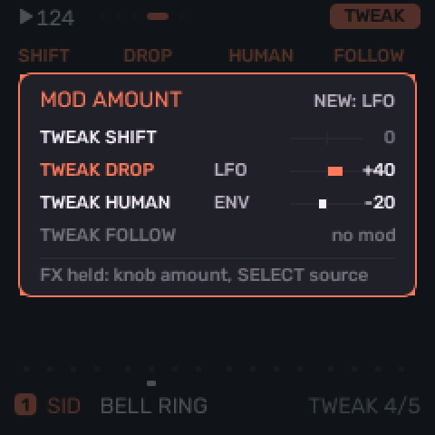

---

## Help card

Hold **ARP** and turn any knob: a card with its parameter, its value and what it does. The value does not change.
Turn the **same knob** further to make the text larger (while it still fits); a long text scrolls instead. Turn back
to go smaller or scroll up. Let go of ARP to close it.

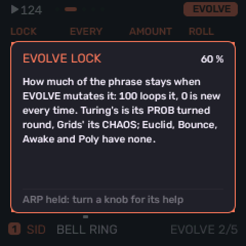

---

## Menu and settings

Hold **HOME** for the menu. Tessera's additions:

| Item | What it does |
|---|---|
| **COLOR** | The palette: SMALTI (Tessera's own), MARMO, VITRO, NIGHT or CONTRAST. |
| **MIDI OUT** | What goes out over USB MIDI: **KEYS** (the notes you play, as Melodee sent them), **ALL** (also the steps, the ARP, recordings and every generator) or **OFF**. Each track on its own channel (GLO > SYSTEM, ROUT; a drum track on the DRUM channel). |
| **CLOCK OUT** | 24 pulses a beat with START and STOP over USB, while the clock is INT. |
| **TRACK KNOB** | RIGHT: the ALGORITHM knob picks the track and PRESETS browses sounds, as printed. LEFT: the two swap. |
| **ABOUT** | Version, credits and, after a crash, LAST CRASH (until power-off). |

---

## Saving and older projects

Generator settings, seeds, sections, layers and cords are saved with the project, in their own block next to it.
Projects saved by earlier Tess versions load and convert, and every new setting starts at a value that plays as
before. Stock Melodee projects load with every track on STEP. Melodee's own preset banks are not carried over.

---

## If something goes wrong

- **Single core.** If your FM-1 crashes with the standard build (red crash screen, freezes, or restarts into update
  mode), install the `-1core` firmware from the same release.
- **TESSERA CRASH.** If the crash screen shows, take a photo; after a restart, MENU > ABOUT shows LAST CRASH until
  power-off. Please add both to a bug report.
- **Update mode.** Hold **OCT-** alone while switching on to start the update loader, then reinstall from the web
  installer. See [docs/RECOVERY.md](docs/RECOVERY.md) for a unit stuck in UBOOT.
- Do not unplug the FM-1 while it is writing. This is experimental firmware: use it at your own risk.

---

## Credits

Tessera stands on other people's ideas and work:

- **Melodee** by keremimo, and **Felucca** by Leo Kuroshita / Hügelton Instruments: the firmware Tessera is built on.
- **Grids** by Émilie Gillet / Mutable Instruments: the GRIDS generator's drum map and the way it is read.
- **norns** scripts, as ideas restated in C (no code copied): **Awake** (tehn) for AWAKE, **Fall** (ambalek) for
  BOUNCE's FALL, **Constellation** (timothy-taylor) for CONSTELLATION, **initenere** for QUAD, and **nørgård** for
  SERIES.
- **Turing Machine** (Music Thing Modular) for TURING.
- **Triple Sloth** by Nonlinear Circuits (Andrew Fitch), with J. C. Sprott's jerk system, for SLOTH; **ochd** by
  Instruō and DivKid for OCHD (ideas only, no code copied).

Every third-party part and its licence is listed in [LICENSING.md](LICENSING.md).
