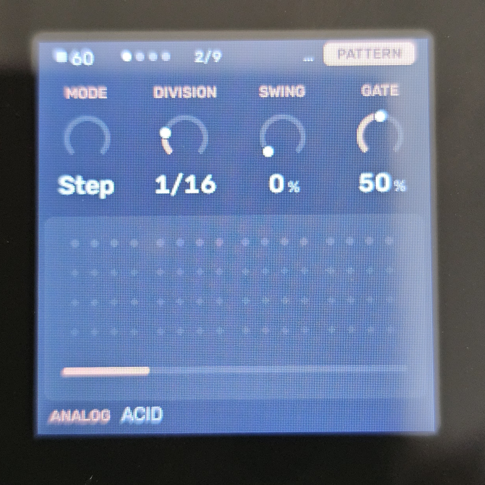

# Melodee (Tess)

A fork of the M-Vave FM-1 alt-firmware [Melodee](https://github.com/keremimo/melodee) (Leo Kuroshita / Hügelton Instruments, GPL-3.0-only). **Status: Experimental.**

---

## What It Is

**Melodee (Tess)** adds algorithmic note generators to the four tracks, plus controls for evolving them over time, building song forms from them, and saving them with the project. Each track can stay a normal step sequencer or be switched to a Tessera engine. 

The sound engines, effects, and core infrastructure are unchanged. The build outputs `melodee-tess.fwsc`.

---

## Engines & UI Walkthrough

On the **PATTERN** page, the **MODE** knob switches a track between `STEP` (the original sequencer) and one of four generative engines:

### 1. Standard Step Sequencer (`STEP`)

### 2. Turing Engine
A looping shift register in the style of a Turing Machine (`LEN`, `PROB`, `SPAN`).

### 3. Euclidean Engine
Euclidean rhythms (`STEPS`, `PULSE`, `ROT`) using track-saved seed pitches.

### 4. Markov Engine
A random walk over 8 scale degrees (`LEAP`, `DENS`, `SPAN`).

### 5. Morph Engine
A rhythm blended between two preset patterns (`POS`, `SNP A`, `SNP B`).

---

## Control Pages

### Evolve Page

* `LOCK`: Deja vu control determining how much of the phrase repeats.
* `EVERY`: Mutates the phrase every (`OFF`, `1`, `2`, `4`, `8`, or `16` bars).
* `AMOUNT`: Degree of change per mutation.
* `ROLL`: Instantly triggers a mutation.

### Form Page

* Builds sections from mutated phrases (`AB`, `ABAC`, `ABCB`, `AABA`, `ABCA`, or `AABC`). 
* `CONTRAST`: Varies new sections relative to previous ones.
* `CLEAR`: Forgets B and C, resetting the current phrase to A.

### Tweak Page

* `SHIFT`: Transposes up to 24 semitones.
* `DROP`: Probability of dropping a hit across any engine.
* `HUMAN`: Adds velocity and gate variation.
* `FOLLOW`: Plays another Tessera track's pitch, shifted, in this track's scale.

*(Note: The **FLOURISH** knob is located on the FORM page, shifting the last beat of the last bar of each phrase into section transitions).*

---

## Saving & Storage

Tessera state is saved with the project into its own dedicated flash object (`OBJ_TESSERA` at `0x9D000`, utilizing the free sector pair) because the main project record is near capacity. 

* **Tagging & Validation**: Each slot's block carries a hash of its parent project record. If hashes mismatch, the project loads with Tessera `OFF` to prevent stale data. Every field is range-checked.
* **Compatibility**: Projects saved by stock Melodee load normally with Tessera `OFF`, and projects saved by this fork remain readable.

---

## Licence

GPL-3.0-only, inherited from Melodee. Original copyright and SPDX headers are preserved.
