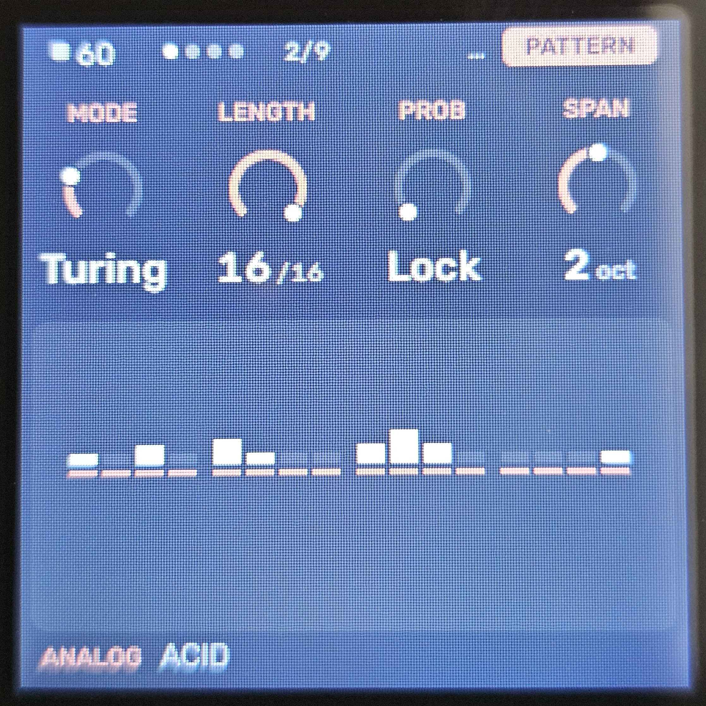
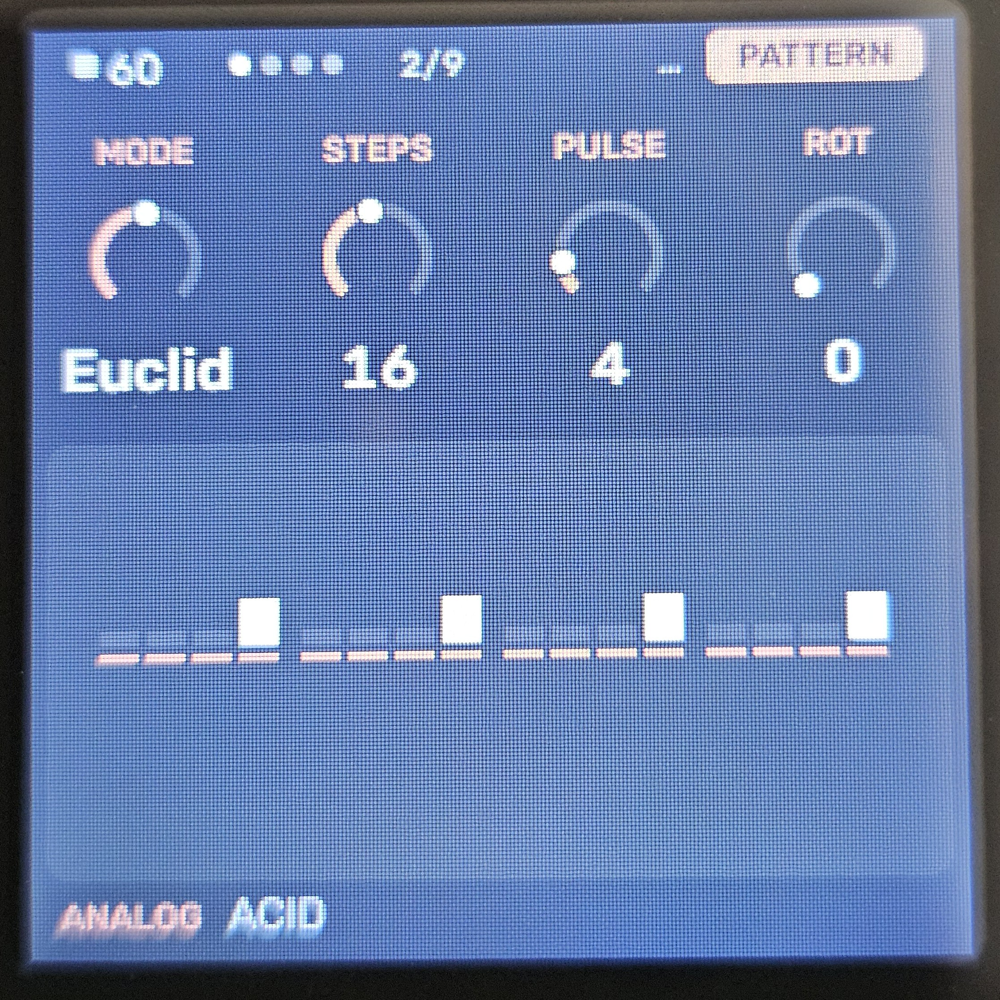
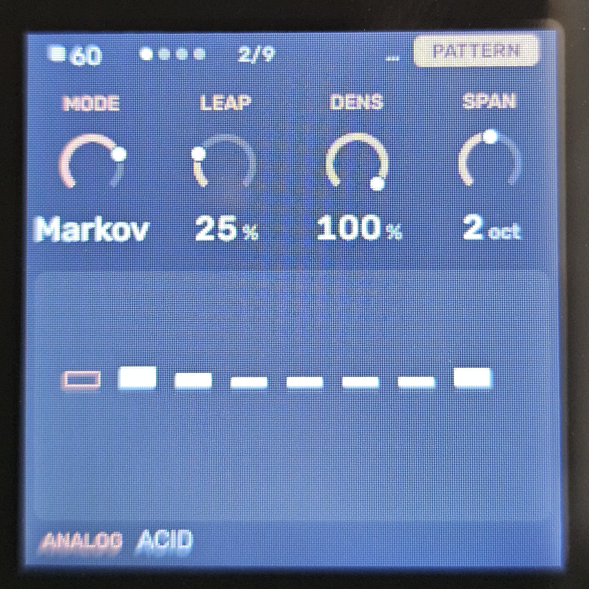
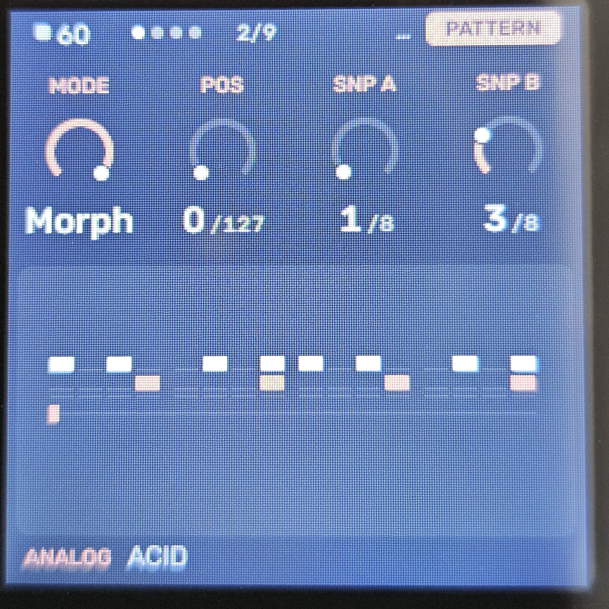
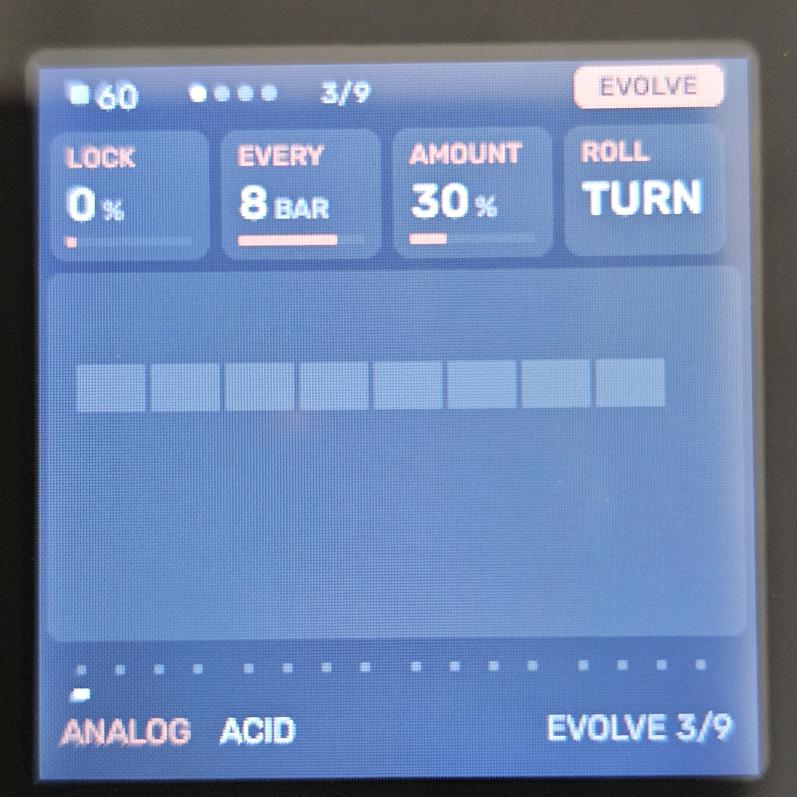
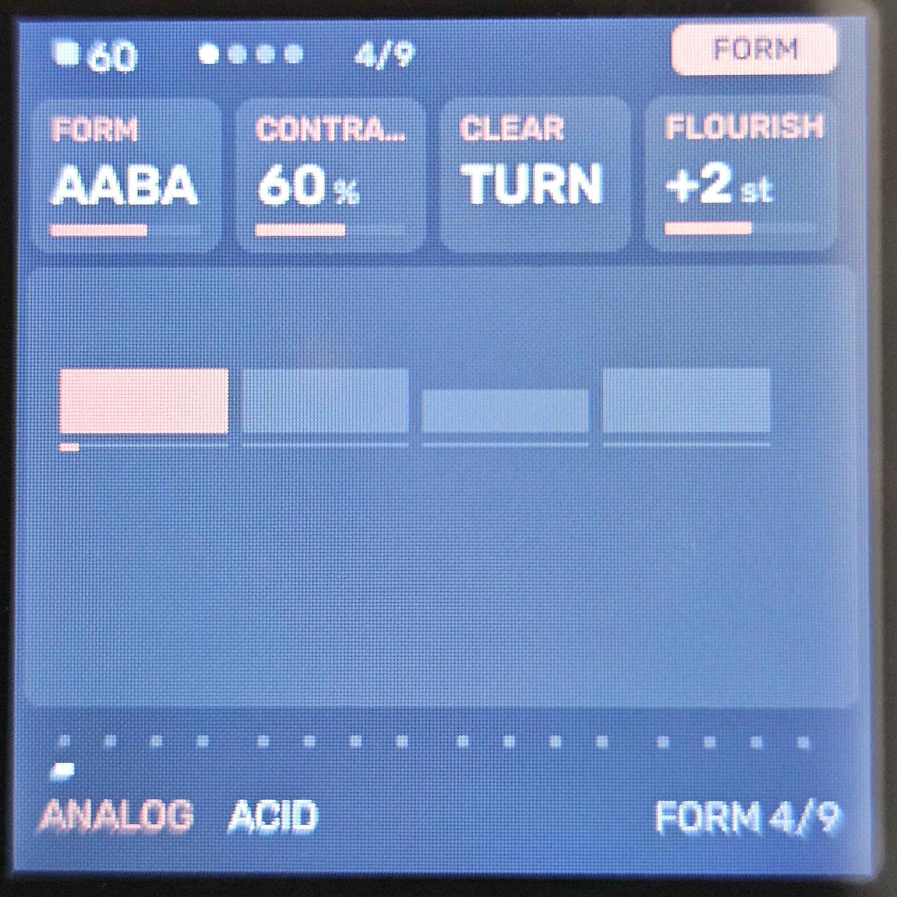
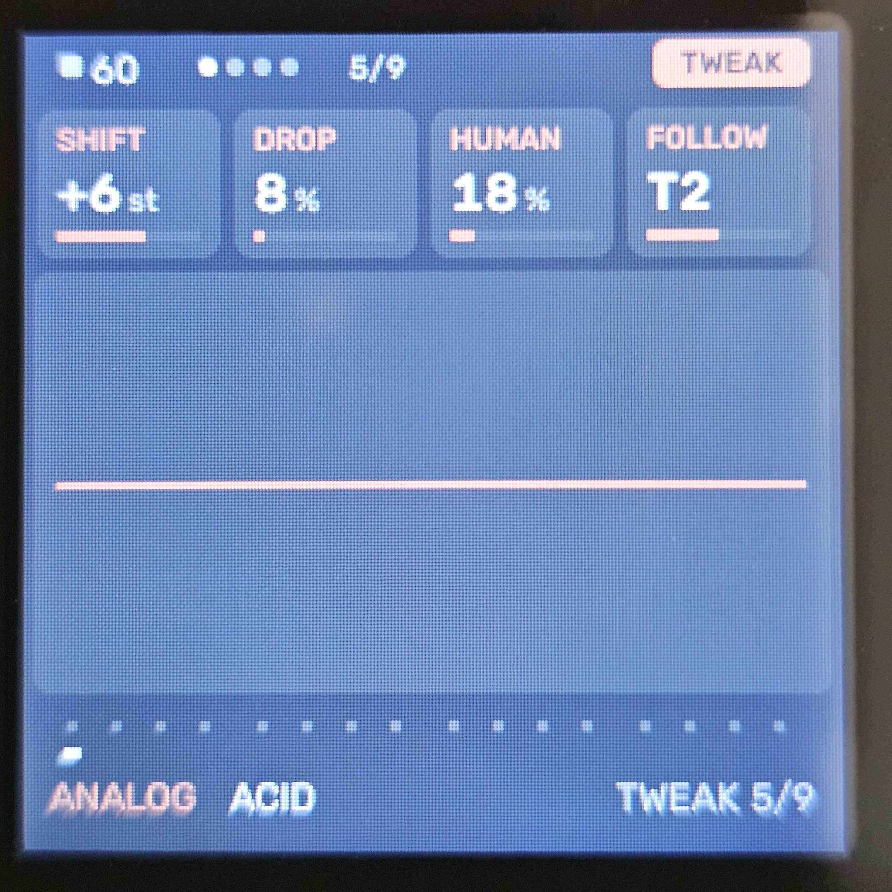

# Melodee (Tess)

A fork of the M-Vave FM-1 alt-firmware [Melodee](https://github.com/keremimo/melodee) developed by **keremimo** (itself built upon *Felucca* by **Leo Kuroshita / Hügelton Instruments**). GPL-3.0-only. **Status: Experimental.**

**Based on Melodee 1.1.0 (pre-release):** upstream commit [`0bc95e8`](https://github.com/keremimo/melodee/commit/0bc95e8) "prepare 1.1.0" (10 October 2026), one day before the final [v1.1.0](https://github.com/keremimo/melodee/releases/tag/v1.1.0) release. Changes upstream made after that are not included yet.

**[Try it in your browser](https://rastapopolix.github.io/melodee-tess/webapp/sim/)**: the firmware running on an on-screen FM-1, with the same engines, sequencer and Tessera generators. No FM-1 or install needed; press *Play the demo* to hear the generators.

---

## Install

Flash it from your browser (Chrome or Edge, FM-1 connected directly by USB):

**[Web installer](https://rastapopolix.github.io/melodee-tess/webapp/installer/)**

After installing, you can edit sounds and sequences from the computer with the [web editor](https://rastapopolix.github.io/melodee-tess/webapp/editor/).

Do not unplug the FM-1 while it is writing. This is experimental firmware and use is at your own risk. The installer page also has a way back to the official V15 firmware, with a backup first.

---

## What It Is

**Melodee (Tess)** adds algorithmic note generators to the four tracks, plus controls for evolving them over time, building song forms from them, and saving them with the project. Each track can stay a normal step sequencer or be switched to a Tessera engine. 

The sound engines, effects, and core infrastructure are unchanged. The build outputs `melodee-tess.fwsc`.

---

## Engines & Workflow

On the **PATTERN** page, the **MODE** knob switches a track between the original step sequencer (`STEP`) inherited from upstream Melodee and one of four new generative engines:

* **Turing**: A looping shift register in the style of a Turing Machine (`LEN`, `PROB`, `SPAN`).
* **Euclid**: Euclidean rhythms (`STEPS`, `PULSE`, `ROT`) using track-saved seed pitches.
* **Markov**: A random walk over 8 scale degrees (`LEAP`, `DENS`, `SPAN`).
* **Morph**: A rhythm blended between two preset patterns (`POS`, `SNP A`, `SNP B`).

---

## Control Pages

* **Evolve Page**: 
  * `LOCK`: Deja vu control determining how much of the phrase repeats.
  * `EVERY`: Mutates the phrase every (`OFF`, `1`, `2`, `4`, `8`, or `16` bars).
  * `AMOUNT`: Degree of change per mutation.
  * `ROLL`: Instantly triggers a mutation.

* **Form Page**: 
  * Builds sections from mutated phrases (`AB`, `ABAC`, `ABCB`, `AABA`, `ABCA`, or `AABC`). 
  * `CONTRAST`: Varies new sections relative to previous ones.
  * `CLEAR`: Forgets B and C, resetting the current phrase to A.

* **Tweak Page**: 
  * `SHIFT`: Transposes up to 24 semitones.
  * `DROP`: Probability of dropping a hit across any engine.
  * `HUMAN`: Adds velocity and gate variation.
  * `FOLLOW`: Plays another Tessera track's pitch, shifted, in this track's scale.

*(Note: The **FLOURISH** knob is located on the FORM page, shifting the last beat of the last bar of each phrase into section transitions).*

---

## Saving & Storage

Tessera state is saved with the project into its own dedicated flash object (`OBJ_TESSERA` at `0x9D000`, utilizing the free sector pair) because the main project record is near capacity. 

* **Tagging & Validation**: Each slot's block carries a hash of its parent project record. If hashes mismatch, the project loads with Tessera `OFF` to prevent stale data. Every field is range-checked.
* **Compatibility**: Projects saved by stock Melodee load normally with Tessera `OFF`, and projects saved by this fork remain readable.

---

## Visual Reference Gallery

### 1. Turing Engine

### 2. Euclidean Engine

### 3. Markov Engine

### 4. Morph Engine

### 5. Evolve Page

### 6. Form Page

### 7. Tweak Page

---

## Licence

GPL-3.0-only, inherited from Melodee. Original copyright and SPDX headers are preserved.
