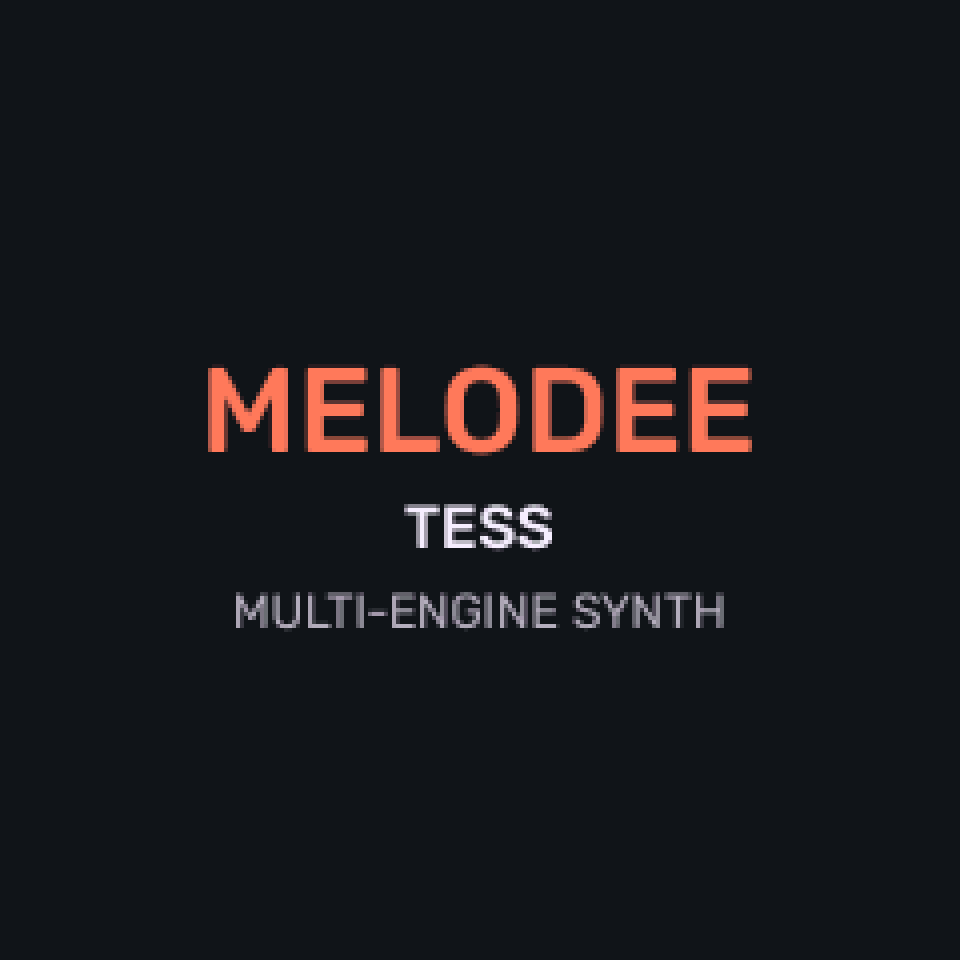
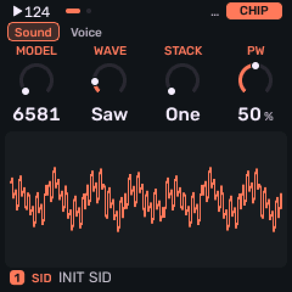
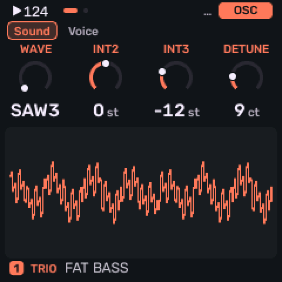
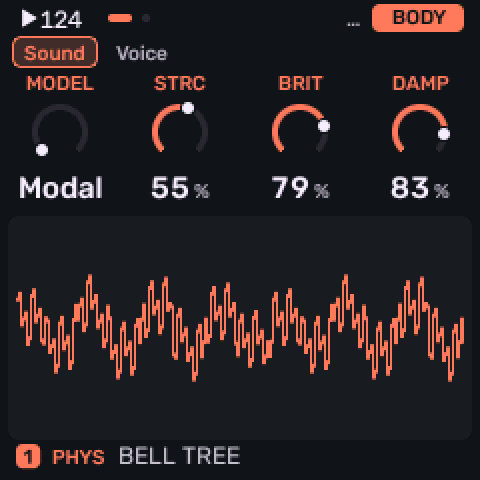

# Melodee (Tess)

A fork of the M-Vave FM-1 alt-firmware [Melodee](https://github.com/keremimo/melodee) developed by **keremimo** (itself built upon *Felucca* by **Leo Kuroshita / Hügelton Instruments**). GPL-3.0-only. **Status: Experimental.**

Melodee (Tess) is the testbed for **Tessera**, a standalone FM-1 firmware in progress with its own generative character. Expect features to change between releases.

**Latest release: [v1.3.3](https://github.com/Rastapopolix/melodee-tess/releases/latest)**, based on Melodee 1.3.6 with picks from 1.4.1. Also listed on [altstrument.org](https://altstrument.org/firmware/m-vave-fm-1/melodee-tess).

**[Try it in your browser](https://rastapopolix.github.io/melodee-tess/webapp/sim/)**: the firmware running on an on-screen FM-1, with the same engines, sequencer and Tessera generators. No FM-1 or install needed; press *Play the demo* to hear the generators.

---

## Install

Flash it from your browser (Chrome or Edge, FM-1 connected directly by USB):

**[Web installer](https://rastapopolix.github.io/melodee-tess/webapp/installer/)**

After installing, you can edit sounds and sequences from the computer with the [web editor](https://rastapopolix.github.io/melodee-tess/webapp/editor/).

Do not unplug the FM-1 while it is writing. This is experimental firmware and use is at your own risk. The installer page also has a way back to the official V15 firmware, with a backup first.

---

## What It Is

**Melodee (Tess)** adds algorithmic note generators to the four tracks, plus controls for evolving them over time, building song forms from them, and saving them with the project. Each track can stay a normal step sequencer or be switched to a Tessera engine. 

The build outputs `melodee-tess.fwsc` (standard, dual core) and `melodee-tess-1core.fwsc` (single core, for FM-1s that crash with the standard build).

---

## Using it

**[Read the manual](MANUAL.md)** for every Tess page, knob and shortcut, and recipes such as
[Grids variations that repeat](MANUAL.md#recipe-grids-variations-that-repeat).

The short version:

* **Tap SEQ** for **GEN**, where **KNOB 1 (MODE)** picks what the track plays; SEQ then shows only that mode's pages. The modes are the step sequencer (`STEP`), the arpeggiator (`ARP`, also the ARP button) and the generators:
  * **Turing**: a looping shift register in the style of a Turing Machine (`LENGTH`, `PROB`, `SPAN`).
  * **Euclid**: Euclidean rhythms (`STEPS`, `PULSE`, `ROT`) on pitches picked by the track's seed.
  * **Markov**: a random walk over 8 scale degrees (`LEAP`, `DENS`, `SPAN`).
  * **Morph**: a rhythm blended between two preset patterns (`POS`, `SNP A`, `SNP B`).
  * **Grids**: Mutable Instruments Grids' drum map, kick, snare and hat (`X`, `Y`, `DENS`).
  * **Bounce**: balls bouncing in a box, a note at each wall hit (`SPEED`, `ANGLE`, `BALLS`).
  * **Awake**: two loops in the style of norns' Awake, steps settable from the keys (`LEN A`, `LEN B`, `PROB`).
  * **Poly**: four notes stepped on by four rhythms (`RHY`, `DIV`, `SPAN`).
* **EVOLVE** mutates the phrase every few bars (`LOCK`, `EVERY`, `AMOUNT`); **ROLL** picks the track's seed, a line you can always come back to.
* **FORM** builds sections A, B and C into forms such as `AABA`; **TWEAK** transposes, thins, humanises or follows another track.
* **TWEAK 2** branches hits to another track's sound (BRANCH), combines them with another track's (LOGIC), and plays them only on certain bars (COND).
* **Tap LFO to MODS** for 16 modulation cords between any source and destination on any track, generators included. Each track has slow organic sources, SLOTH and OCHD (LFO > ORGANIC); knobs show live marks where the cords move them, and **MATRIX** shows which tracks modulate which.
* **Hold FX and turn a knob** to set how far a cord modulates that knob's parameter.
* **Hold ARP and turn a knob** to see what that knob does.

---

## Saving & Storage

Generator settings, seeds, FORM sections and the cords are saved with the project, in their own flash object (`OBJ_TESSERA` at `0x9D000`) because the main project record is near capacity. The current block format is version 5 ("TSR5", with BRANCH, LOGIC, COND, SLOTH and OCHD); projects and backups saved by earlier Tess versions still load and convert.

* **Tagging & Validation**: Each slot's block carries a hash of its parent project record. If hashes mismatch, the project loads with Tessera `OFF` to prevent stale data. Every field is range-checked.
* **Compatibility**: Projects saved by stock Melodee load normally with Tessera `OFF`, and projects saved by this fork remain readable.

---

## To come

Planned for later Tess builds. Plans can change, and nothing here has a date yet.

* **More sounds**: a pad voice, a chord pad/drone mode that holds one chord a bar and changes it with the FORM sections, and our own pad, pluck and lead voices.
* **More generators**: a few smaller modes.
* **A new UI**: an optional Monomachine-style look (black and white, shapes instead of colours) as a separate firmware build.

---

## Visual Reference Gallery

*The pages as v1.3.3 draws them, rendered on the host from the firmware's own drawing code (`tests/gallery_render.c` in the firmware sources) and shown at 2x.*

### Sequencing

<table>
<tr>
<td align="center" valign="top" width="50%"> <b>SEQ MODE</b> Tap SEQ for GEN: KNOB 1 picks STEP, ARP or a generator, and SEQ then shows only that mode's pages.</td>
<td align="center" valign="top" width="50%"> <b>HOME</b> The four tracks, their sounds and knobs, with the scope below.</td>
</tr>
</table>

### Generators

<table>
<tr>
<td align="center" valign="top" width="50%"> <b>Turing</b> A looping shift register: LENGTH, PROB (Lock holds the loop), SPAN.</td>
<td align="center" valign="top" width="50%"> <b>Euclid</b> Euclidean rhythms: STEPS, PULSE, ROT, on pitches from the track's seed.</td>
</tr>
<tr>
<td align="center" valign="top" width="50%"> <b>Markov</b> A random walk over 8 scale degrees: LEAP, DENS, SPAN.</td>
<td align="center" valign="top" width="50%"> <b>Morph</b> A rhythm blended between two preset patterns: POS, SNP A, SNP B.</td>
</tr>
<tr>
<td align="center" valign="top" width="50%"> <b>Grids</b> Grids' drum map, kick, snare and hat: X, Y, DENS.</td>
<td align="center" valign="top" width="50%"> <b>Bounce</b> Balls bouncing in a box, a note at each wall hit: SPEED, ANGLE, BALLS.</td>
</tr>
<tr>
<td align="center" valign="top" width="50%"> <b>Awake</b> Two loops in the style of norns' Awake, steps settable from the keys: LEN A, LEN B, PROB.</td>
<td align="center" valign="top" width="50%"> <b>Poly</b> Four notes stepped on by four rhythms over up to 3 octaves: RHY, DIVISION, SPAN.</td>
</tr>
</table>

### Shaping the phrase

<table>
<tr>
<td align="center" valign="top" width="50%"> <b>EVOLVE</b> Mutates the phrase every few bars: LOCK, EVERY, AMOUNT; ROLL picks the seed.</td>
<td align="center" valign="top" width="50%"> <b>TWEAK</b> SHIFT, DROP, HUMAN and FOLLOW, each drawn on the page.</td>
</tr>
<tr>
<td align="center" valign="top" width="50%"> <b>TWEAK 2 (new)</b> BRANCH hits to another track's sound, LOGIC with another track's hits, COND for certain bars.</td>
<td align="center" valign="top" width="50%"> <b>ORGANIC (new)</b> Each track's SLOTH (TORPOR, APATHY, INERTIA) and eight OCHD LFOs, slow sources for the cords.</td>
</tr>
<tr>
<td align="center" valign="top" width="50%"> <b>Help card</b> Hold ARP and turn a knob to see what it does.</td>
<td align="center" valign="top" width="50%"> <b>MODS</b> Tap LFO for 16 modulation cords between any source and destination, generators included.</td>
</tr>
<tr>
<td align="center" valign="top" width="50%"> <b>Mod shortcut</b> Hold FX and turn a knob to set how far a cord moves that parameter.</td>
<td align="center" valign="top" width="50%"> <b>Live mod mark (new)</b> A knob a cord reaches shows where the cords move it now: here an OCHD sweeping BRANCH.</td>
</tr>
<tr>
<td align="center" valign="top" width="50%"> <b>MATRIX (new)</b> The cords track by track, lit as they move. OCT+ opens one in MODS.</td>
</tr>
</table>

### Sound engines

<table>
<tr>
<td align="center" valign="top" width="50%"> <b>SID</b> The C64 chip, 6581 or 8580 model.</td>
<td align="center" valign="top" width="50%"> <b>TRIO</b> Three oscillators: WAVE, INT2, INT3, DETUNE.</td>
</tr>
<tr>
<td align="center" valign="top" width="50%"> <b>PHYS</b> Physical modelling (Rings / DaisySP): MODEL, STRC, BRIT, DAMP.</td>
</tr>
</table>

---

## Licence

GPL-3.0-only, inherited from Melodee. Original copyright and SPDX headers are preserved.
